# ☕ clean-decent-tablet

**Turn the Samsung tablet that ships with a Decent Espresso DE1 into a quieter, dedicated espresso controller. No rooting, and every change can be undone.**

Made by the team behind [Decadent](https://decadentcoffee.app), and useful whether or not you use it.

<p align="center">
  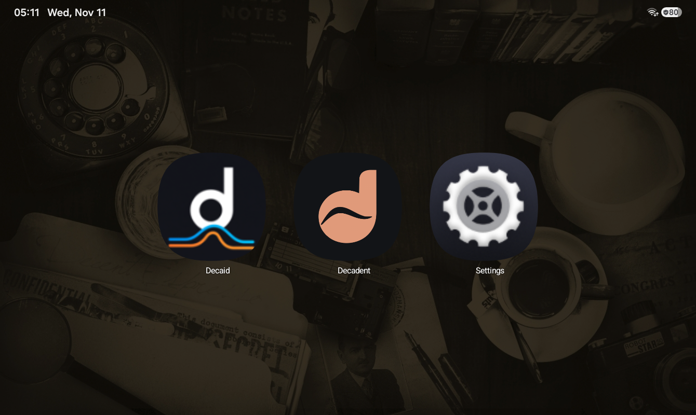
</p>

> [!NOTE]
> **Work in progress.** Tested on one tablet: a Samsung SM-X133 on One UI 8.5. A full setup and undo has passed only on a simulated tablet so far. [`docs/compatibility.md`](docs/compatibility.md) lists exactly what has been tested.

## 🧭 Why we made this

This started as part of building [Decadent](https://decadentcoffee.app), our dial-in companion app for the DE1. We wanted getting started on the tablet to feel smooth: Decaid installed, a clear Home screen with a few large icons, and nothing else competing for attention or quietly sending data in the background. Getting there meant installing Decaid, switching off a lot of bundled apps and replacing Samsung's launcher.

The result turned out useful on its own, so we're releasing it. You don't need Decadent to use it: the clean-up and the new Home screen work for any DE1 owner, and Decadent is one optional icon.

The idea behind it: the tablet's job is to run your DE1. Out of the box it also carries a phone's worth of apps and background services that have nothing to do with espresso, and many of them send data back to someone. So **keep what the DE1 and the tablet's safety need, and switch off the rest.**

- **Fewer things phoning home.** Games, shopping, sharing features and Samsung's data and advertising agents are switched off. Each one is a source of telemetry and a target for updates and pop-ups the machine never needed.
- **Keep updates and security patches.** Samsung's firmware updater stays, so the tablet still gets Android security updates. That keeps a little of Samsung's diagnostics running, the price of patches.
- **One browser: Chrome.** A web app like Decadent needs a browser that stays up to date. Android already runs on Google's browser engine (Android System WebView) and Google Play services, so Chrome adds no new company to the list. Samsung Internet would add another.
- **A Google account, any one.** Signing in lets the Play Store keep Chrome and WebView updated, and lets Chrome install web apps such as Decadent full screen. We suggest a new account just for the tablet, because the tablet has no lock. One you already use works too.
- **Nothing deleted, everything reversible.** Apps are switched off, not removed, and undo puts it all back.

## ✨ What you get

Pick either option, or both.

| | Option | What it does |
|---|---|---|
| 🧹 | **Clean up** | Disables about 100 bundled apps and background services: games, shopping, Samsung data agents, sharing features. They are disabled, not deleted. Chrome becomes the browser. The screen sleeps after 10 minutes, and a double-tap wakes it. |
| 🏠 | **New Home screen** | Fossify Launcher with three large icons: **Decaid**, **Decadent** and **Settings**. Swipe gestures replace the bottom buttons, so apps get the whole screen. Samsung's side panel is removed. |

Those three icons are our suggestion, not a requirement. Decadent is optional: the Home screen works just as well without it, and you can put any app there. Everything else stays in the app list.

## 🛡️ What stays

- ✅ **Every app Decent ships:** the original Decent app (AndroWish), Decaid, SE Profiler, Coffee Flow, File Manager + and AZ Screen Recorder.
- ✅ **What the tablet needs:** Bluetooth, Wi-Fi, Settings, the keyboard, Samsung firmware updates and USB debugging.
- ✅ **The tablet's own system software:** no root, no bootloader unlock, no custom firmware and no factory reset.
- ✅ **Your espresso machine:** nothing is sent to it. Setup never starts heating, pumping or brewing.

## 🚀 Three ways to set it up

All three run the same script on the tablet ([`device/decent-setup.sh`](device/decent-setup.sh)), and each one can undo it.

| | Who it's for | How | Status |
|---|---|---|---|
| 🌐 | **Anyone** | **Webpage** ([`web/`](web/)). Open it in Chrome or Edge, plug in the tablet and follow the steps. You can untick any app you want to keep. | Built. At [decadentcoffee.app/clean-decent-tablet](https://decadentcoffee.app/clean-decent-tablet/), or [run it yourself](#-run-the-webpage). Not yet run on a real tablet. |
| 💻 | **Comfortable in a terminal** | **Script:** `scripts/setup.sh`, with `--cleanup` or `--home` to pick one option, and `--keep <ids>` to leave apps on. | Dry runs pass on the reference tablet. A full setup and undo passes on a simulated tablet. |
| 🤖 | **Using an AI coding agent** | **Runbook:** give [`docs/AGENT_RUNBOOK.md`](docs/AGENT_RUNBOOK.md) to the agent. | Written from the steps tested here. |

Every screen of the webpage is shown below, under [What you'll see](#-what-youll-see).

Only two steps need you: joining Wi-Fi and signing in to Google, plus logging in to Decadent if you use it. The page then finishes the tablet itself: restart, Home screen layout, Play updates and the Decadent install. A Decaid that has never been opened asks a few first questions; the page answers them for you (no Decent account for now, yes to Bluetooth, notifications and running in the background) and pauses only at a screen it does not know. The account and the import of your old shots stay in Decaid, on its Dashboard under Account and Data. The written instructions for every step are always on the page if you would rather do one yourself. The full manual walk-through is in [`docs/installation.md`](docs/installation.md).

## 👀 What you'll see

The webpage walks you through twelve screens. Without a tablet plugged in, choose **Preview the steps** on the first screen and scroll through them all: a pretend tablet fills the screens and nothing can be pressed. Choose **Get started** to begin for real. These pictures are captured with the built-in safe mode (`?safe`), which pretends to be a tablet and has Next / Back buttons.

<table>
<tr>
<td width="50%">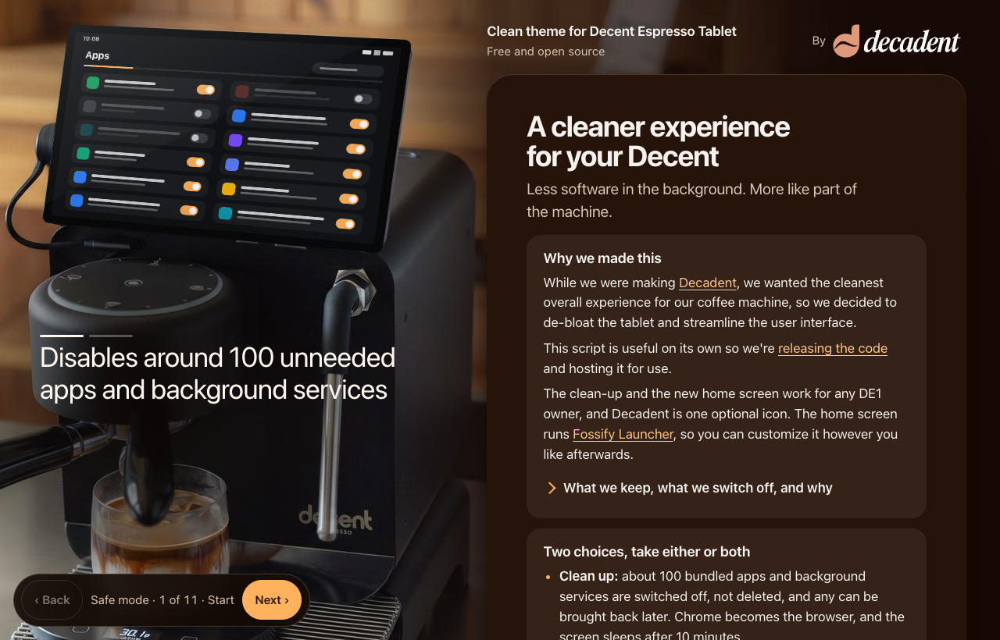<br><sub><b>1. Start.</b> What changes, what stays, and why we made it.</sub></td>
<td width="50%">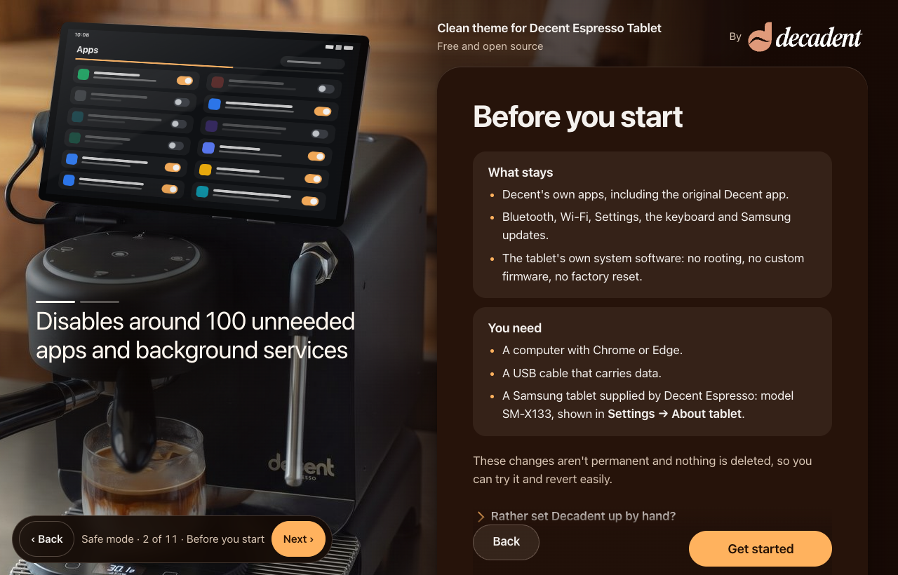<br><sub><b>2. Before you start.</b> What you need: Chrome or Edge, a data cable, the SM-X133.</sub></td>
</tr>
<tr>
<td width="50%">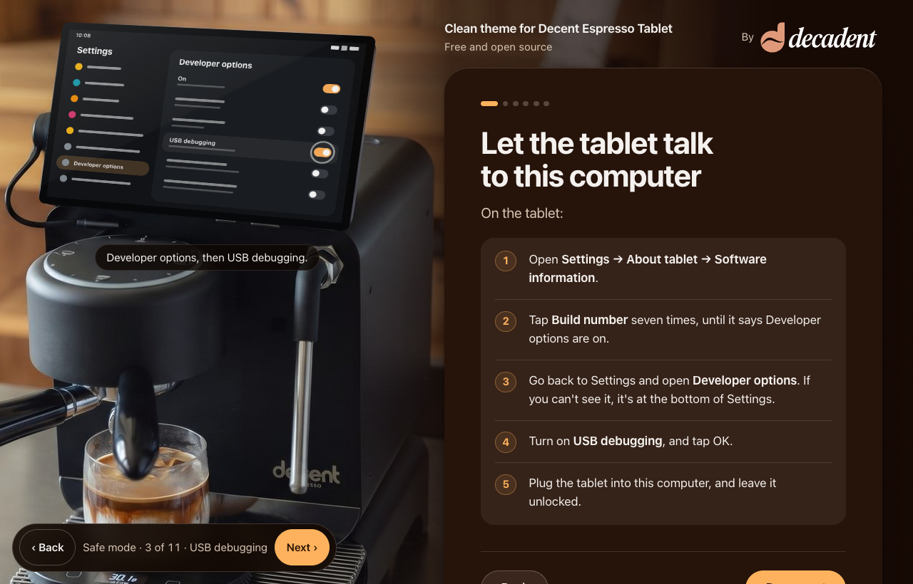<br><sub><b>3. Let the tablet talk to the computer.</b> Turn on USB debugging.</sub></td>
<td width="50%">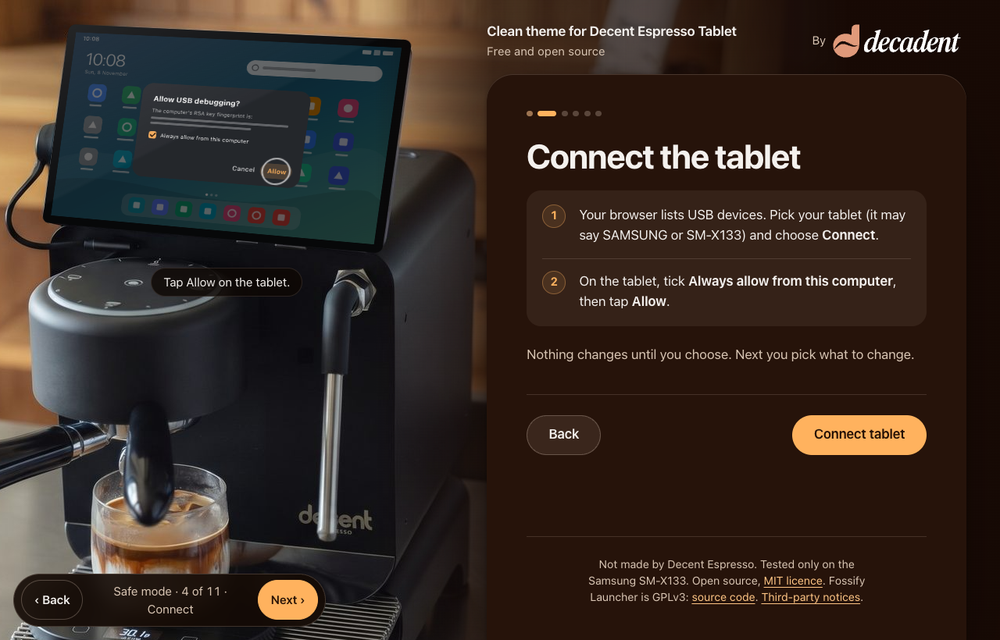<br><sub><b>4. Connect.</b> Pick the tablet, then tap Allow on it.</sub></td>
</tr>
<tr>
<td width="50%">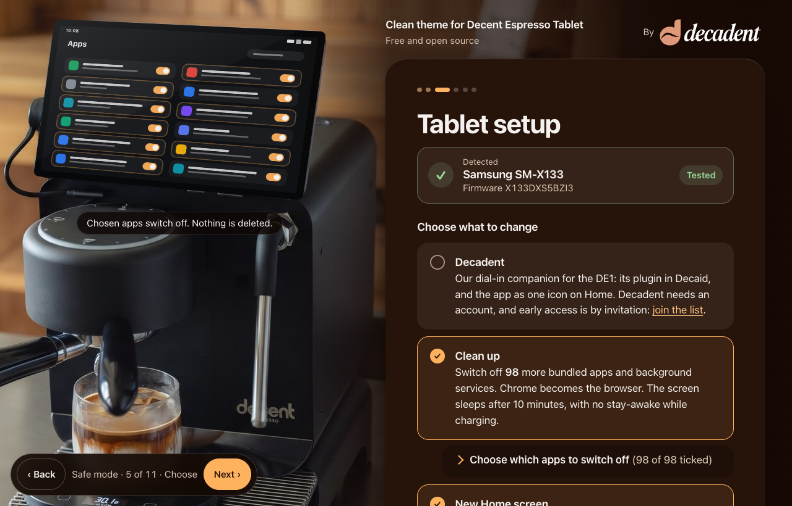<br><sub><b>5. Tablet setup.</b> It opens as soon as the tablet allows the connection and shows what it is reading while it checks. Then the model and firmware the tablet reports, whether that pair is tested, and the choices: Clean up and New Home screen while there is something to do, and Turn apps back on and Put the original Home screen back once this page has changed them.</sub></td>
<td width="50%">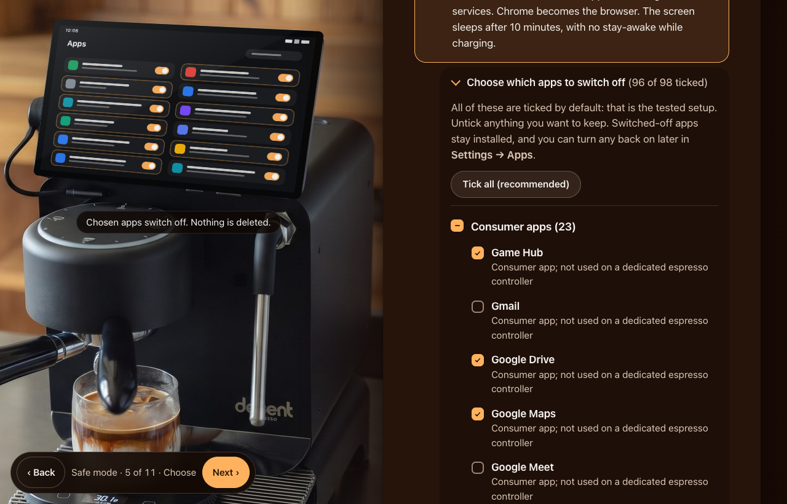<br><sub><b>6. Pick apps (optional).</b> Everything is ticked by default. Untick anything you want to keep.</sub></td>
</tr>
<tr>
<td width="50%">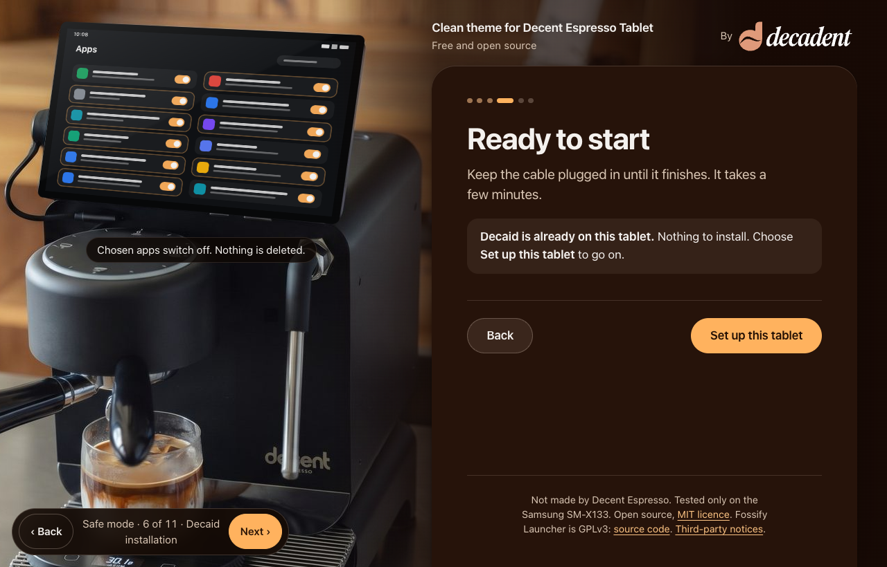<br><sub><b>7. Decaid.</b> Install Decaid if it isn't on the tablet yet, or skip it.</sub></td>
<td width="50%">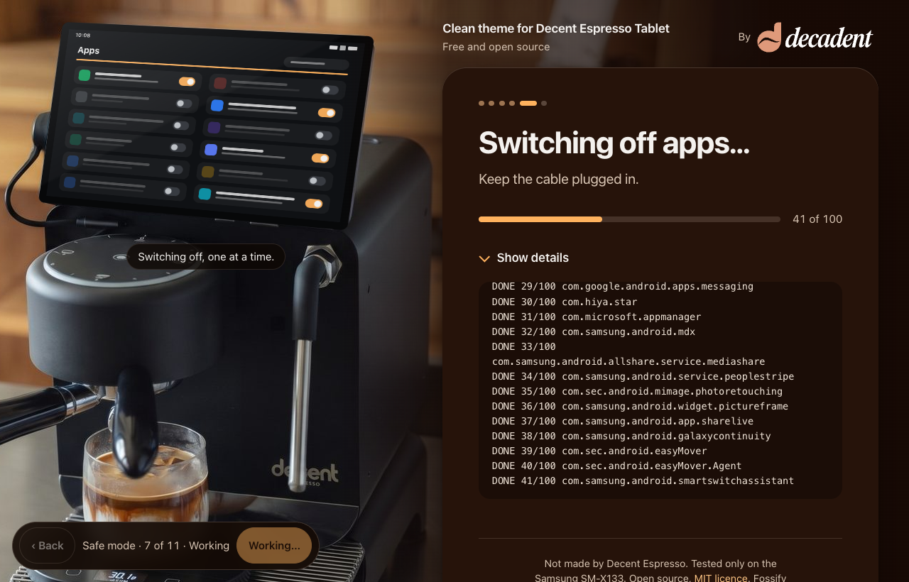<br><sub><b>8. Working.</b> A few minutes; keep the cable in. Show details lists each app as it goes.</sub></td>
</tr>
<tr>
<td width="50%">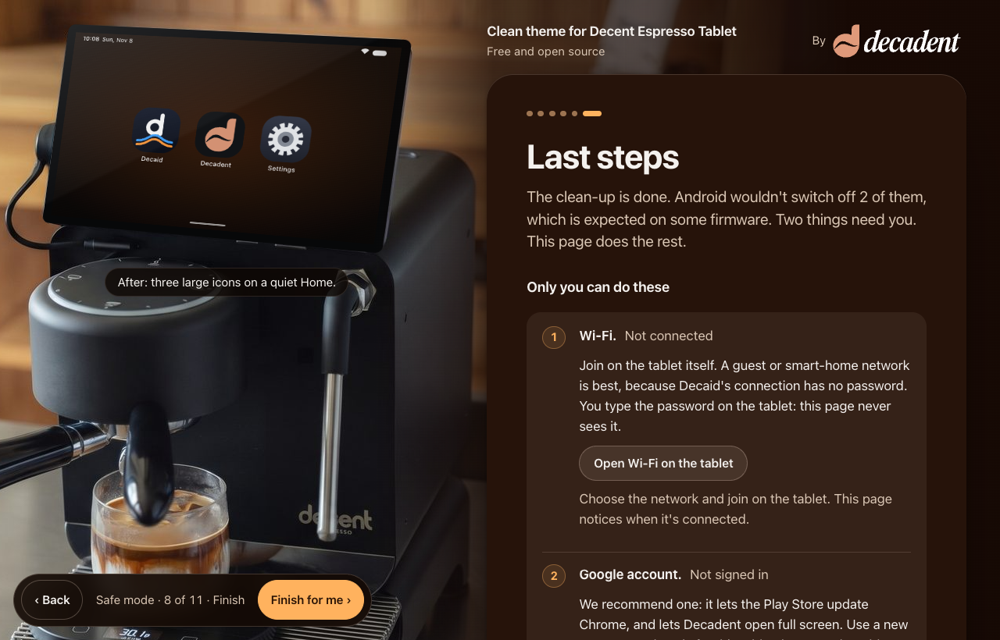<br><sub><b>9. Last steps.</b> You join Wi-Fi and sign in to Google; the page does the rest.</sub></td>
<td width="50%">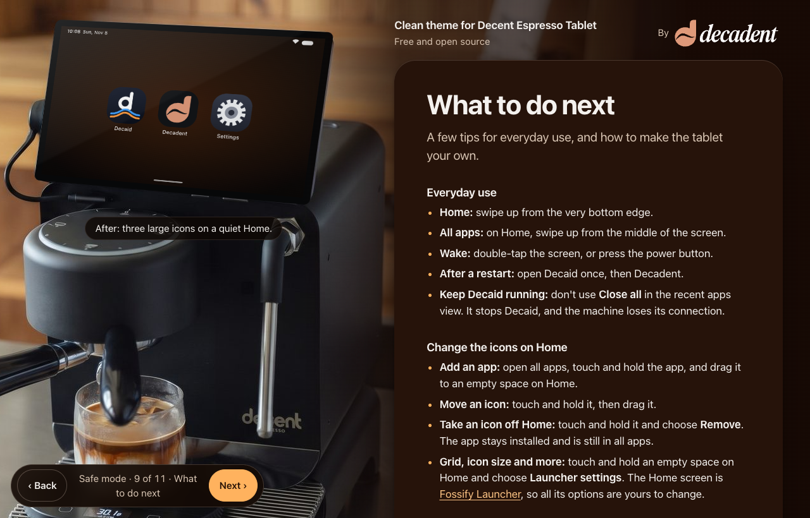<br><sub><b>10. What to do next.</b> Everyday use, changing the Home icons, and getting an app back.</sub></td>
</tr>
<tr>
<td width="50%">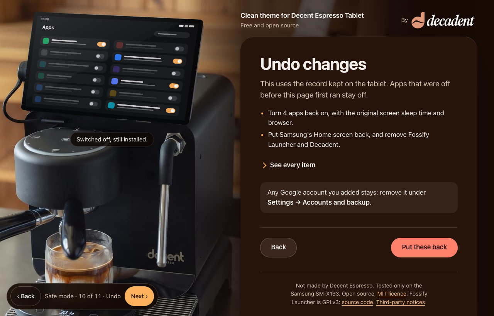<br><sub><b>11. Undo, any time later.</b> Tick Turn apps back on (all or some), Put the original Home screen back, or both on Tablet setup, then confirm here.</sub></td>
<td width="50%">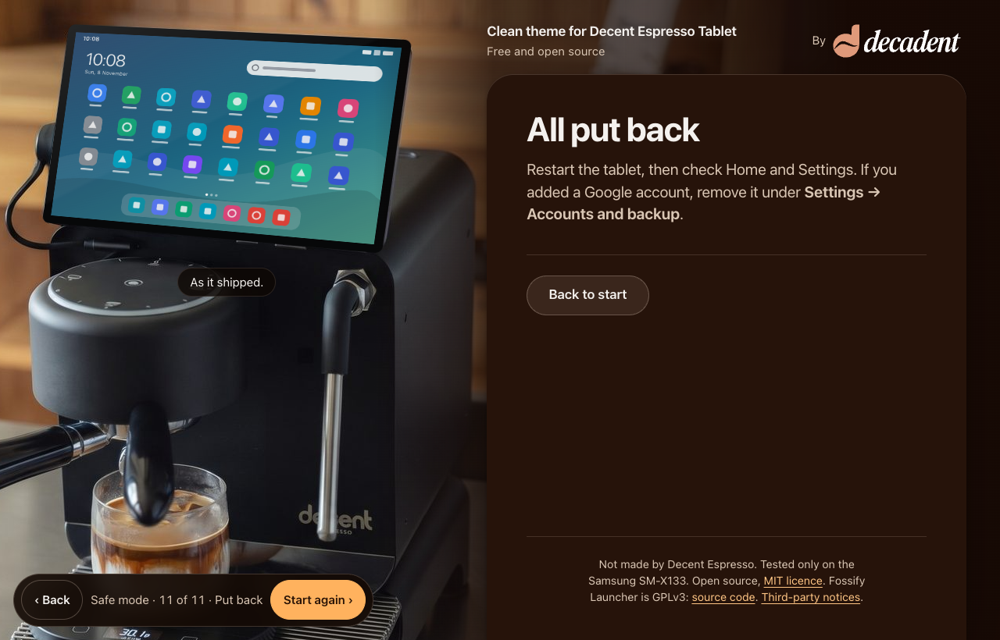<br><sub><b>12. Undone.</b> Restart the tablet and it is as it was.</sub></td>
</tr>
</table>

And the result, the new Home screen:

<p align="center"></p>

## 🧪 Run the webpage

The webpage is online at [decadentcoffee.app/clean-decent-tablet](https://decadentcoffee.app/clean-decent-tablet/): open it in Chrome or Edge. To run it on your own computer instead:

1. Install [Node.js](https://nodejs.org) 22 or later.
2. Build it:
   ```sh
   cd web && npm ci && npm run build
   ```
3. Serve the built page on your own computer:
   ```sh
   python3 -m http.server 8000 --directory dist
   ```
4. Open `http://localhost:8000` in **Chrome or Edge**. WebUSB needs Chrome or Edge, and an `https://` address or `localhost`.
5. If you have ever used Android tools on this computer, run `adb kill-server` first. Only one program can use the tablet at a time.

To look around without a tablet, choose **Preview the steps** and scroll down the page, or open `http://localhost:8000/?safe` (safe mode: a pretend tablet with Next / Back). Safe mode also works online: [decadentcoffee.app/clean-decent-tablet/?safe](https://decadentcoffee.app/clean-decent-tablet/?safe).

## ❓ What if I use one of the other apps?

Nothing that came with the tablet is uninstalled, so everything you use is still there:

- **Decent's own apps** (the original Decent app, SE Profiler, Coffee Flow, File Manager +, AZ Screen Recorder) are never touched. They just aren't on the Home screen.
- **Open any app from the app list:** on the Home screen, swipe up from the middle of the screen. The search bar at the top finds anything.
- **Put it on the Home screen:** in the app list, touch and hold the app, then drag it to an empty space.
- **Want an app that Clean up switched off?** Untick it on the webpage before you start. Or turn it back on later in **Settings → Apps**: open the filter, show disabled apps, open the app and tap **Enable**.
- **YouTube** is kept, just not on the Home screen. Add it as above.

The original Decent app runs on a program called **AndroWish**, and only its **Decent** icon opens it: AndroWish opened from the app list shows nothing. So the new Home always keeps that icon. On a tablet with no Decaid the Home leads with it, with **Update Decent** on the second page; with Decaid it sits on the second page, between Decent's other apps.

## ↩️ Undo

Undo puts back exactly what setup changed, in two parts you can take separately: **turn apps back on** (all of them or just some) and **put the original Home screen back**.

- It re-enables only the apps this project disabled. Apps that were already off stay off.
- It restores the original Home screen, browser and settings.
- It removes the apps setup added, unless you choose to keep them.

The record of the original state is kept **on the tablet** (`/data/local/tmp/decent-tablet`), so undo works from any computer. On the webpage, connect the tablet and tick **Turn apps back on**, **Put the original Home screen back** or both on the Tablet setup screen. Each shows only when the tablet has that change. Or use `scripts/undo.sh` (`--apps`, `--home`, `--pkgs <ids>`).

Samsung's own Home screen comes back with its icons exactly as they were, because setup never touches it. If you keep Fossify installed, its layout stays too, ready if you switch back. A factory reset deletes that record, and gives you Samsung's setup, not Decent's.

## 📋 Every app it disables, and why

Disabled apps stay installed. You can turn any of them back on in **Settings → Apps**, or undo everything at once. All of this is generated from [`manifests/packages.csv`](manifests/packages.csv), and [`docs/packages.md`](docs/packages.md) also covers what is kept and why.

<!-- disabled-apps:start -->
<!-- Generated by scripts/render-packages.py from manifests/packages.csv. Do not edit by hand. -->

| | Group | Apps |
|---|---|---|
| 📺 | **Consumer apps** (23) | Google Drive, Google Maps, Google Photos, Google Meet, … |
| 🔗 | **Sharing, linking and companion features** (24) | Google Messages, Hiya caller ID (Smart Call), Link to Windows, Galaxy Buds manager, … |
| 🔁 | **Replaced or not needed** (4) | Gemini, Samsung Contacts, My Files, Samsung Internet |
| 📡 | **Samsung data collection and promotion agents** (11) | Recommended-apps agent, Parental controls, App Update Center, Separated Apps, … |
| ⚙️ | **Samsung services with wider effects** (6) | Google app, Digital Wellbeing, Samsung voice wake-up (name only), Samsung Experience Service, … |
| 🧹 | **Small background services** (32) | Auto-install config, Android easter egg, Partner bookmarks, Google restore, … |

<details><summary>📺 <b>Consumer apps</b>: 23 apps</summary>

| App | Package | Why it is disabled |
|---|---|---|
| Game Hub | `com.samsung.android.game.gamehome` | Consumer app; not used on a dedicated espresso controller |
| Gmail | `com.google.android.gm` | Consumer app; not used on a dedicated espresso controller |
| Google Drive | `com.google.android.apps.docs` | Consumer app; not used on a dedicated espresso controller |
| Google Maps | `com.google.android.apps.maps` | Consumer app; not used on a dedicated espresso controller |
| Google Meet | `com.google.android.apps.tachyon` | Consumer app; not used on a dedicated espresso controller |
| Google Photos | `com.google.android.apps.photos` | Consumer app; not used on a dedicated espresso controller |
| Google TV | `com.google.android.videos` | Consumer app; not used on a dedicated espresso controller |
| Microsoft 365 (Office) | `com.microsoft.office.officehubrow` | Consumer app; not used on a dedicated espresso controller |
| Microsoft OneDrive | `com.microsoft.skydrive` | Consumer app; not used on a dedicated espresso controller |
| Microsoft Outlook | `com.microsoft.office.outlook` | Consumer app; not used on a dedicated espresso controller |
| Netflix | `com.netflix.mediaclient` | Consumer app; not used on a dedicated espresso controller |
| Samsung Calendar | `com.samsung.android.calendar` | Consumer app; not used on a dedicated espresso controller |
| Samsung Free / News | `com.samsung.android.app.spage` | Consumer app; not used on a dedicated espresso controller |
| Samsung Global Goals | `com.samsung.sree` | Consumer app; not used on a dedicated espresso controller |
| Samsung Health | `com.sec.android.app.shealth` | Consumer app; not used on a dedicated espresso controller |
| Samsung Kids | `com.sec.android.app.kidshome` | Consumer app; not used on a dedicated espresso controller |
| Samsung Kids installer | `com.samsung.android.kidsinstaller` | Consumer app; not used on a dedicated espresso controller |
| Samsung Members | `com.samsung.android.voc` | Consumer app; not used on a dedicated espresso controller |
| Samsung Notes | `com.samsung.android.app.notes` | Consumer app; not used on a dedicated espresso controller |
| Samsung Shop | `com.samsung.ecomm.global.gbr` | Consumer app; not used on a dedicated espresso controller |
| Spotify | `com.spotify.music` | Consumer app; not used on a dedicated espresso controller |
| Voice Recorder | `com.sec.android.app.voicenote` | Consumer app; not used on a dedicated espresso controller |
| YouTube Music | `com.google.android.apps.youtube.music` | Consumer app; not used on a dedicated espresso controller |

</details>

<details><summary>🔗 <b>Sharing, linking and companion features</b>: 24 apps</summary>

| App | Package | Why it is disabled |
|---|---|---|
| Audio mirroring | `com.samsung.android.audiomirroring` | Linking, sharing or companion feature; no use on a Wi-Fi espresso tablet |
| Call & text on other devices | `com.samsung.android.mdecservice` | Linking, sharing or companion feature; no use on a Wi-Fi espresso tablet |
| Galaxy Buds manager | `com.samsung.accessory.budsunitemgr` | Linking, sharing or companion feature; no use on a Wi-Fi espresso tablet |
| Galaxy Wearable stub | `com.samsung.android.app.watchmanagerstub` | Linking, sharing or companion feature; no use on a Wi-Fi espresso tablet |
| Gallery stories | `com.samsung.storyservice` | Linking, sharing or companion feature; no use on a Wi-Fi espresso tablet |
| Google Messages | `com.google.android.apps.messaging` | Linking, sharing or companion feature; no use on a Wi-Fi espresso tablet |
| Hiya caller ID (Smart Call) | `com.hiya.star` | Linking, sharing or companion feature; no use on a Wi-Fi espresso tablet |
| Link to Windows | `com.microsoft.appmanager` | Linking, sharing or companion feature; no use on a Wi-Fi espresso tablet |
| Link to Windows service (Samsung) | `com.samsung.android.mdx` | Linking, sharing or companion feature; no use on a Wi-Fi espresso tablet |
| Media share service | `com.samsung.android.allshare.service.mediashare` | Linking, sharing or companion feature; no use on a Wi-Fi espresso tablet |
| People edge panel | `com.samsung.android.service.peoplestripe` | Linking, sharing or companion feature; no use on a Wi-Fi espresso tablet |
| Photo editor | `com.sec.android.mimage.photoretouching` | Linking, sharing or companion feature; no use on a Wi-Fi espresso tablet |
| Picture frame widget | `com.samsung.android.widget.pictureframe` | Linking, sharing or companion feature; no use on a Wi-Fi espresso tablet |
| Quick Share | `com.samsung.android.app.sharelive` | Linking, sharing or companion feature; no use on a Wi-Fi espresso tablet |
| Samsung Flow | `com.samsung.android.galaxycontinuity` | Linking, sharing or companion feature; no use on a Wi-Fi espresso tablet |
| Smart Switch | `com.sec.android.easyMover` | Linking, sharing or companion feature; no use on a Wi-Fi espresso tablet |
| Smart Switch agent | `com.sec.android.easyMover.Agent` | Linking, sharing or companion feature; no use on a Wi-Fi espresso tablet |
| Smart Switch assistant | `com.samsung.android.smartswitchassistant` | Linking, sharing or companion feature; no use on a Wi-Fi espresso tablet |
| Smart View (screen mirroring) | `com.samsung.android.smartmirroring` | Linking, sharing or companion feature; no use on a Wi-Fi espresso tablet |
| SmartThings Find | `com.samsung.android.app.find` | Linking, sharing or companion feature; no use on a Wi-Fi espresso tablet |
| Sticker center | `com.samsung.android.stickercenter` | Linking, sharing or companion feature; no use on a Wi-Fi espresso tablet |
| Tasks edge panel | `com.samsung.android.app.taskedge` | Linking, sharing or companion feature; no use on a Wi-Fi espresso tablet |
| Video editor music | `com.sec.android.app.ve.vebgm` | Linking, sharing or companion feature; no use on a Wi-Fi espresso tablet |
| Wallpaper and style gallery | `com.samsung.android.app.dressroom` | Linking, sharing or companion feature; no use on a Wi-Fi espresso tablet |

</details>

<details><summary>🔁 <b>Replaced or not needed</b>: 4 apps</summary>

| App | Package | Why it is disabled |
|---|---|---|
| Gemini | `com.google.android.apps.bard` | AI assistant added by One UI 8.5; not needed on an espresso controller |
| My Files | `com.sec.android.app.myfiles` | Samsung's file manager. File Manager +, which Decent ships, stays |
| Samsung Contacts | `com.samsung.android.app.contacts` | No calls or contacts on a Wi-Fi tablet |
| Samsung Internet | `com.sec.android.app.sbrowser` | Samsung's browser. Chrome becomes the browser instead |

</details>

<details><summary>📡 <b>Samsung data collection and promotion agents</b>: 11 apps</summary>

| App | Package | Why it is disabled |
|---|---|---|
| App Update Center | `com.samsung.android.app.updatecenter` | Updates Samsung's own apps. Not the firmware updater, which stays |
| BBC agent | `com.samsung.android.bbc.bbcagent` | Collects device information; manages trusted apps in Knox containers |
| Customization Service | `com.samsung.android.rubin.app` | Collects usage data for personalised ads |
| Device quality agent | `com.samsung.android.dqagent` | Diagnostic logging to Samsung |
| Dual Messenger | `com.samsung.android.da.daagent` | No use here |
| Knox analytics uploader | `com.samsung.android.knox.analytics.uploader` | Sends analytics to Samsung |
| Parental controls | `com.samsung.android.app.parentalcare` | No use here |
| Recommended-apps agent | `com.samsung.android.app.omcagent` | Installs Samsung recommended apps after setup |
| Samsung Cloud | `com.samsung.android.scloud` | No Samsung account is signed in |
| Separated Apps | `com.samsung.android.appseparation` | Sandbox for work and personal apps; no use here |
| Smart suggestions | `com.samsung.android.smartsuggestions` | Suggestion feature; no use here |

</details>

<details><summary>⚙️ <b>Samsung services with wider effects</b>: 6 apps</summary>

| App | Package | Why it is disabled |
|---|---|---|
| Digital Wellbeing | `com.samsung.android.forest` | Screen-time tracking; not needed here |
| Galaxy Store | `com.sec.android.app.samsungapps` | Samsung's app store. Updates to Samsung's own apps through it stop |
| Google app | `com.google.android.googlequicksearchbox` | Google app: Discover, OK Google and Circle to Search. Chrome still works |
| Samsung Experience Service | `com.samsung.android.mobileservice` | Samsung sign-in and group sharing stop; most of those apps are already disabled |
| Samsung push service | `com.sec.spp.push` | Samsung notifications. Firmware updates still arrive with it off (tested) |
| Samsung voice wake-up (name only) | `com.samsung.android.intellivoiceservice` | Samsung voice wake-up (purpose inferred from its name) |

</details>

<details><summary>🧹 <b>Small background services</b>: 32 apps</summary>

| App | Package | Why it is disabled |
|---|---|---|
| Android easter egg | `com.android.egg` | No use here |
| Auto Doodle | `com.sec.android.autodoodle.service` | Photo editor add-on. Not present on One UI 8.5 |
| Auto-install config | `android.autoinstalls.config.samsung` | Installs OEM apps at setup |
| Battery data collector | `com.samsung.sait.sohservice` | Collects battery data |
| Beacon manager | `com.samsung.android.beaconmanager` | Nearby device scanning |
| Broadcast service | `com.sec.bcservice` | Hidden diagnostic and TCP dump tool |
| Chrome customisations | `com.sec.android.app.chromecustomizations` | Samsung items on Chrome's homepage |
| Clipboard edge panel | `com.samsung.android.app.clipboardedge` | Edge panel |
| Continuity service | `com.samsung.android.mcfds` | Cross-device feature |
| Daily Board | `com.samsung.android.homemode` | Slideshow mode |
| Deskphone manager config | `com.samsung.android.sdm.config` | No use here |
| DSMS | `com.samsung.android.dsms` | Hidden diagnostic logging |
| Game optimizer | `com.samsung.android.game.gos` | Game service |
| Google feedback | `com.google.android.feedback` | Sends crash reports |
| Google restore | `com.google.android.apps.restore` | Backup restore wizard; runs on boot |
| Handwriting service | `com.samsung.android.sdk.handwriting` | No pen in use |
| IAFT | `com.sec.android.iaft` | Dump and error tracing |
| IMS logger | `com.sec.imslogger` | Logging for calling; Wi-Fi tablet |
| Multi-device kit | `com.samsung.android.mdx.kit` | Support for linking apps already disabled |
| Nearby device setup | `com.samsung.android.easysetup` | Pop-ups for nearby devices |
| Partner bookmarks | `com.android.providers.partnerbookmarks` | Partner bookmarks in Chrome |
| Private access tokens | `com.samsung.android.privateaccesstokens` | Used by Samsung Internet, already disabled |
| Quick Tools | `com.sec.android.app.quicktool` | Ruler and compass edge panel |
| Recommendation agent | `com.samsung.android.mapsagent` | Auto-installs recommended apps |
| Safety information | `com.samsung.safetyinformation` | Static text |
| Samsung checkout | `com.sec.android.app.billing` | Samsung Store purchases |
| Secure Folder | `com.samsung.knox.securefolder` | Not in use |
| Service consent | `com.samsung.android.dbsc` | Pairs with Samsung push for consent prompts |
| Shortcut backup | `com.samsung.android.shortcutbackupservice` | Part of Smart Switch, already disabled |
| Smart Call | `com.samsung.android.smartcallprovider` | Caller ID; Wi-Fi tablet |
| Volume monitor | `com.sec.android.app.volumemonitorprovider` | Earphone volume data for Digital Wellbeing |
| Weather daemon | `com.sec.android.daemonapp` | Weather and finance widgets |

</details>

<!-- disabled-apps:end -->

## ⚠️ Risks and limits

- Disabling the wrong system package can break a feature. Every change is logged, and undo reverses it.
- A list of packages is **not a backup**. It records which apps exist, not their data or settings.
- **Only the Samsung SM-X133 is tested**, the tablet supplied with recent DE1 machines. Earlier Decent tablets came with different apps, so on any other model the webpage warns you and changes nothing until you accept. Then it switches off only the listed apps that tablet has, still protects Decent's apps and the essentials, and some finishing steps may fall back to written instructions. On an SM-X133 with firmware we haven't tested, it warns you and asks you to accept before it shows the options. The script works the same way, with `--force` in place of accepting.

## 🗂️ What's in this repo

| Path | What |
|---|---|
| [`docs/installation.md`](docs/installation.md) | The full manual setup guide |
| [`docs/packages.md`](docs/packages.md) | Every package: disabled, kept, and why |
| [`docs/compatibility.md`](docs/compatibility.md) | Tested devices and results |
| [`docs/recovery.md`](docs/recovery.md) | Getting back from mistakes |
| [`docs/AGENT_RUNBOOK.md`](docs/AGENT_RUNBOOK.md) | Steps for an AI agent |
| [`docs/decisions.md`](docs/decisions.md) | Why things are the way they are |
| [`docs/launcher.md`](docs/launcher.md) · [`docs/startup.md`](docs/startup.md) · [`docs/debloating.md`](docs/debloating.md) | Launcher choice, sleep and wake, how disabling works |
| [`device/`](device/) | The script that runs on the tablet, and the lists it uses |
| [`scripts/`](scripts/) | `setup`, `undo`, `status`, `verify` and `inventory`, run from a computer |
| [`web/`](web/) | The setup webpage (WebUSB, built on [Tango](https://github.com/yume-chan/ya-webadb), MIT) |
| [`tests/`](tests/) | Setup and undo on a simulated tablet: `tests/sim-tablet.sh` |

## 🙏 Credits

- [Fossify Launcher](https://github.com/FossifyOrg/Launcher) (GPLv3), the Home screen.
- [Tango / ya-webadb](https://github.com/yume-chan/ya-webadb) (MIT), which lets the webpage talk to the tablet over USB.
- [Decent Espresso](https://decentespresso.com), who make the DE1, Decaid and the original app.

Not made by Decent Espresso. Decaid and the Decent app belong to Decent.

## 📄 Licence

Open source under the [MIT licence](LICENSE): use it, change it, share it and build on it, commercially too. Keep the copyright notice. Bundled third-party parts keep their own licences, listed in [NOTICE](NOTICE).
